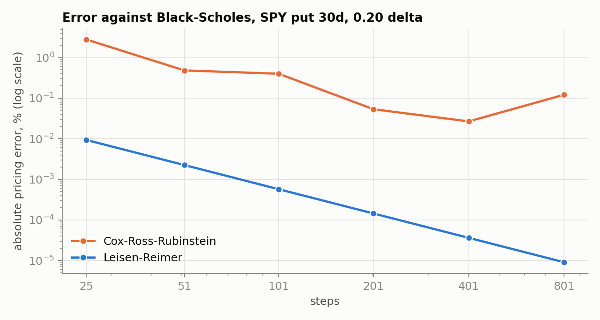
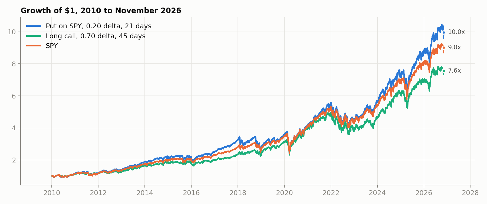

# Derivatives Pricer and Back Tester

An American option pricer (Leisen-Reimer binomial tree) with a volatility smile fitted to a real SPY option chain, used to back test selling SPY puts and buying SPY calls from 2010 to 2026.

Research code. It places no orders and is not financial advice.

## How it works

| Part | What it does |
|---|---|
| Pricer | 201-step Leisen-Reimer tree with early exercise at every node. Cox-Ross-Rubinstein is kept for comparison (`--legacy`) |
| Vol model | at-the-money vol from VIX9D and VIX, interpolated in total variance and scaled to a real chain's level, plus a smile in standardised moneyness, one quadratic per side of the forward |
| Strike picker | finds the strike with a target delta, iterating because the vol depends on the strike |
| Back test | sells a put (on top of SPY, or cash-secured) or buys a call at a target delta and days to expiry, marks it daily, and closes on a profit target, a stop, a time exit or expiry |

## Why Leisen-Reimer

A Cox-Ross-Rubinstein tree spaces its nodes by volatility alone, so the strike lands somewhere different between two nodes every time the step count changes, and the error swings back and forth as it shrinks. Leisen-Reimer sets the up-probabilities so the tree's chance of finishing in the money matches N(d2) and N(d1), through the Peizer-Pratt inversion. That centres the tree on the strike, and the price converges smoothly at about 1/N² instead of 1/N.



At 201 steps Leisen-Reimer is within 0.0005% of Black-Scholes on the puts the back test sells, against 0.08% to 0.15% for Cox-Ross-Rubinstein at the same steps. A pricing takes about 1.3 milliseconds, so a 16-year daily back test runs in seconds.

## The volatility model

- **Level.** VIX9D and VIX give 9-day and 30-day implied vol, interpolated in total variance (vol² x days) for maturities in between. VIX prices a strip of options across all strikes, including the expensive downside puts, so it sits above at-the-money vol. On the real chain, at-the-money vol was 0.81 of the VIX-based number.
- **Smile.** In standardised moneyness x = ln(K/F) / (σ_atm √T), so one shape serves every expiry:
  - below the forward (puts): σ/σ_atm = 1 − 0.153x + 0.025x²
  - above it (calls): σ/σ_atm = 1 − 0.207x + 0.102x²
- **Check** (`smile_fit.py`). Fitted on alternate expiries of the SPY chain at the September 24, 2026 close and checked on the others:
  - error on the held-back expiries is 1.05 vol points, against 3.19 for a flat VIX-based model;
  - the sold puts are priced within a median 8.8% of the market.

## Results, 2010 to November 2026, $500,000

| | Total return | CAGR | Sharpe | Max drawdown |
|---|---|---|---|---|
| best put on SPY (0.20 delta, 21 days) | 896% | 14.6% | 0.66 | -36.3% |
| best call (0.70 delta, 45 days) | 656% | 12.8% | 0.63 | -29.4% |
| SPY | 801% | 13.9% | 0.68 | -33.7% |



Across 12 settings each (delta x 14, 21, 30, 45 days), puts on SPY range from Sharpe 0.61 to 0.66 and calls from 0.35 to 0.63.

| Sharpe, puts on SPY | 14 days | 21 days | 30 days | 45 days |
|---|---|---|---|---|
| 0.15 delta | 0.65 | 0.65 | 0.62 | 0.62 |
| 0.20 delta | 0.64 | 0.66 | 0.63 | 0.61 |
| 0.30 delta | 0.66 | 0.65 | 0.64 | 0.61 |

| Sharpe, long calls | 14 days | 21 days | 30 days | 45 days |
|---|---|---|---|---|
| 0.30 delta | 0.53 | 0.49 | 0.35 | 0.56 |
| 0.50 delta | 0.40 | 0.41 | 0.53 | 0.58 |
| 0.70 delta | 0.40 | 0.51 | 0.57 | 0.63 |

Deeper in-the-money calls do best, since a 0.70-delta call is mostly stock and has less time value to lose. The calls have smaller drawdowns (-23% to -31%) because a call can't lose more than its premium. About half of call trades end on the -50% stop.

Selling puts on a cash-secured basis instead (cash at the 3% rate covering every put) isolates the option trade itself: Sharpe 0.14 to 0.94 over 2010-2017 and negative in every setting from 2018 on, a period with four sharp sell-offs. Rules:

- **Puts:** sold when VIX is 19 or below, closed at 70% of the premium kept or a loss of twice the premium.
- **Calls:** sized to the account's SPY exposure, closed at +100%, -50%, or a third of their life left.

Six alternative entry and exit rules were tested against a rule fixed in advance (better median Sharpe in both 2010-2017 and 2018-2026), and none passed (`rules_study.py`):

| Change | Sharpe 2010-17 | 2018-26 |
|---|---|---|
| original rules | 0.79 | 0.54 |
| no VIX cap | 0.69 | 0.53 |
| sell only when implied vol is above 20-day realised | 0.72 | 0.60 |
| skip days when VIX9D is above VIX | 0.75 | 0.65 |
| take profit at 50% | 0.74 | 0.54 |
| close with a third of the life left | 0.78 | 0.54 |
| stop when the put's delta reaches 0.50 | 0.78 | 0.54 |

Skipping backwardation days was the best in 2018-2026 but worse before, so it wasn't adopted. Full grids are in `results/`.

## Limitations

- The smile comes from one calm day (VIX 15.7) and is applied to sixteen years.
- The fitted model still prices sold puts about 8% below the market, and 0.30-delta calls about 11% below, which biases the puts down and the calls up.
- Stops and targets are checked on daily closes.
- A flat 3% rate and 1.2% dividend yield throughout.
- No margin model for puts sold on top of a full share position.

## Running it

```bash
pip install -r requirements.txt
python tests/test_pricer.py && python tests/test_lr_smile.py
python convergence.py
python smile_fit.py cache/SPY_2026-09-24.json 2026-09-24 767.29   # needs a saved chain, not included
python rules_study.py
python calls_study.py
python pricer.py                          # sweep and one detailed run
python pricer.py --collateral cash        # cash-secured puts
```

| File | What it is |
|---|---|
| `pricer.py` | trees, vol model, strike picker, back test |
| `smile_fit.py`, `validate_surface.py` | the model against a real chain |
| `rules_study.py`, `calls_study.py`, `convergence.py` | the studies above |
| `tests/` | 25 tests, no market data needed |

Tested with Python 3.13.
